  

<a href="https://raw.githubusercontent.com/sailxx/Sailxx/main/assets/hero-motion.svg">▶ Play animation</a>

## Featured projects

- [**Tobi**](https://github.com/sailxx/Tobi) — a desktop companion for monitoring AI coding agents and responding to their requests.
- [**TrayMixer**](https://github.com/sailxx/TrayMixer) — a system tray mixer for switching audio devices and adjusting app volume.
- [**Lumen**](https://github.com/sailxx/Lumen) — a GNOME Shell extension for changing brightness independently on each display.
- [**Okto**](https://github.com/sailxx/Okto) — a planner that brings tasks, calendars and focus sessions together.

## Contact

[Telegram @arkhitkovv](https://t.me/arkhitkovv) · [LeetCode @sailixx](https://leetcode.com/u/sailixx/)
